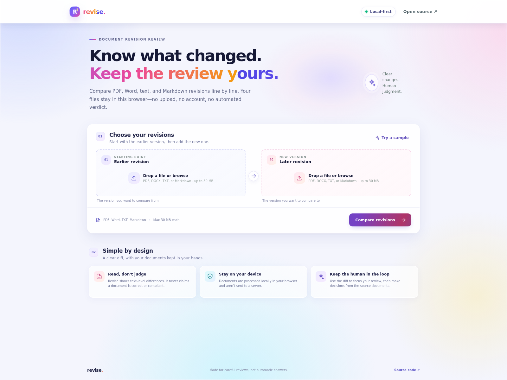

# Revise

**A local-first document revision comparison tool.** Compare two PDFs or text files line by line, review what changed, and export a Markdown summary. Revise is deliberately a text-difference tool—not an automated quality, safety, or compliance verdict.



## Why Revise

Comparing procedure and policy revisions often means scanning long documents for small edits. Revise makes those edits easier to find while leaving interpretation and decisions with the reviewer.

## Features

- Compare PDF, TXT, and Markdown files side by side.
- Extract selectable PDF text in the browser with PDF.js.
- See additions, removals, and changed lines with line numbers.
- Filter to changed lines or search within the comparison.
- Export a Markdown summary for review notes.
- Try the included fictional sample without choosing files.
- Responsive layout with keyboard-friendly controls.

## Privacy and limitations

- Files are read and processed in your browser; Revise has no upload service, account system, analytics, or backend.
- Scanned/image-only PDFs are not OCR'd. Text extraction may flatten tables, columns, or page layout.
- A text diff cannot determine whether a change is correct, safe, or compliant. Always review the original documents before making decisions.
- Maximum input file size: 30 MB per document.

## Run locally

Requires Node.js 22.13+ (or Node.js 24+).

```bash
git clone https://github.com/goutham-valugula/revise.git
cd revise
npm ci
npm run dev
```

Open the local URL printed by Vite (usually `http://localhost:5173`). These steps work on any computer with Git and Node.js installed; the repository is public, so no GitHub login is needed.

## Build and host remotely

To create a production-ready static site:

```bash
npm ci
npm run build
```

Deploy the generated `dist/` directory to any static web host, or copy it to a web server such as Nginx. No application server or backend is required. `npm run preview` is for checking the production build locally, not for running a production service.

## Tech

React, TypeScript, Vite, [PDF.js](https://github.com/mozilla/pdf.js), and [jsdiff](https://github.com/kpdecker/jsdiff). Fonts use system stacks; document parsing and comparison require no third-party service.

## License

MIT. See [LICENSE](LICENSE).
