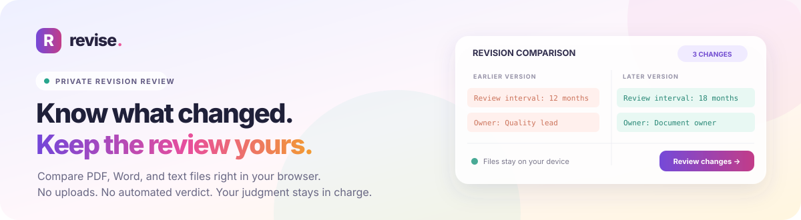

<div align="center">
  <a href="https://goutham-valugula.github.io/revise/">
    
  </a>

  <p><strong>Private, line-by-line document revision review.</strong></p>
  <p>
    <a href="https://goutham-valugula.github.io/revise/"><strong>↗ Open the live app</strong></a>
    &nbsp;·&nbsp;
    <a href="#run-locally">Run it locally</a>
    &nbsp;·&nbsp;
    <a href="https://github.com/goutham-valugula/revise/issues">Report an issue</a>
  </p>

  <p>
    
    
    <a href="LICENSE"></a>
  </p>
</div>

## See the latest interface

<a href="https://goutham-valugula.github.io/revise/"></a>

## Know what changed—without handing over your files

Revise compares two versions of a document and presents additions, removals, and reworded lines side by side. It helps you focus your review; **you stay responsible for interpreting the changes**.

No account or upload is needed. Documents are read and compared in your browser, and Revise has no file-upload backend.

### A quick review flow

1. Add the earlier and later versions—or load the fictional sample to explore the interface.
2. Scan the line-by-line comparison, search for a phrase, or show changed lines only.
3. Export a Markdown summary for your review notes.

### Works with

| Format | What Revise reads | Notes |
| --- | --- | --- |
| **PDF** | Selectable text | Scanned/image-only PDFs are not OCR'd. |
| **Word** | Modern `.docx` files | Legacy `.doc` is not supported. Formatting, tracked changes, tables, and images are not preserved. |
| **Text** | `.txt` and `.md` | Compared as text, line by line. |

Each file can be up to **30 MB**. Extraction can flatten or omit layout, tables, images, or handwriting, so check the source documents before acting on a difference. A text diff cannot decide whether a change is correct, safe, or compliant.

## Run locally

Requires Node.js **22.13+** or **24+**.

```bash
git clone https://github.com/goutham-valugula/revise.git
cd revise
npm ci
npm run dev
```

Open the local address printed by Vite (usually `http://localhost:5173`). No GitHub sign-in is needed to clone this public repository.

## Build and host

```bash
npm ci
npm run build
```

The production-ready static site is written to `dist/`. It can be hosted on GitHub Pages or another static web host; no application server or document backend is required. To preview the build locally, run `npm run preview`.

## Built with

React · TypeScript · Vite · [PDF.js](https://github.com/mozilla/pdf.js) · [Mammoth](https://github.com/mwilliamson/mammoth.js) · [jsdiff](https://github.com/kpdecker/jsdiff)

## License

[MIT](LICENSE)
